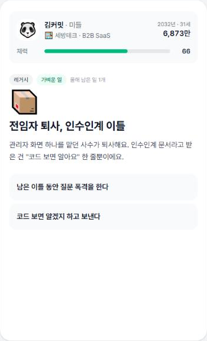
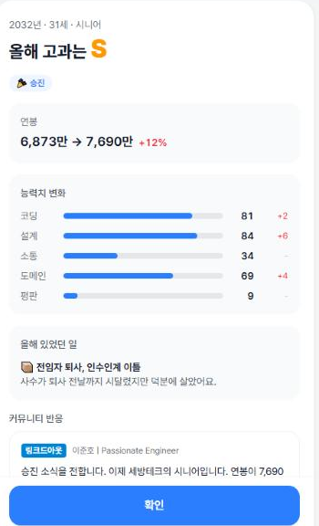
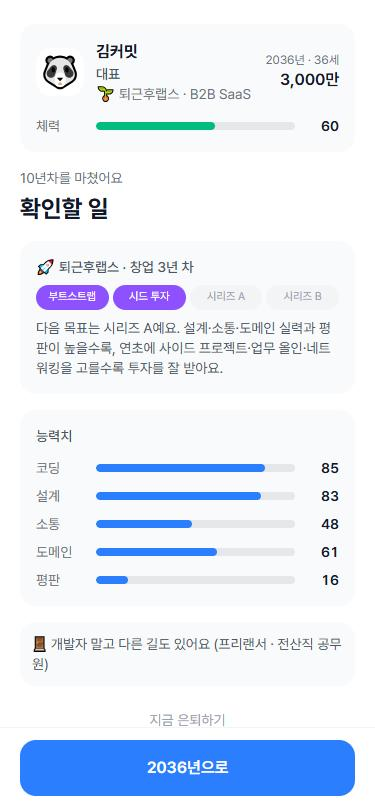
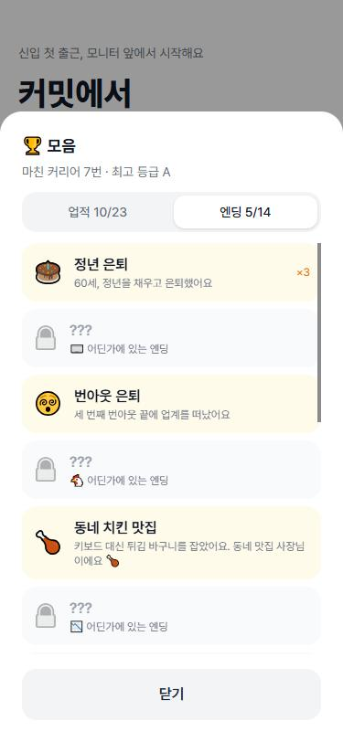

# 커밋에서 은퇴까지

신입 첫 출근부터 은퇴까지, 한국 개발자의 커리어를 1년 단위로 살아보는 풍자 육성 게임입니다.
설치 없이 브라우저에서 바로 플레이할 수 있고, 한 판은 입사부터 은퇴까지 30여 턴입니다.

**▶ 플레이: https://commit-to-retire.commit-to-retire.workers.dev**

[](https://github.com/eodgkekd/commit-to-retire/actions/workflows/ci.yml)

<p>
  
  
  
  
</p>

## 이 프로젝트는

백엔드 개발자가 **AI 코딩 도구 활용 능력을 연습하려고** 만든 사이드 프로젝트입니다.
저는 프론트엔드(React) 경험이 없고, 이 저장소의 코드는 대부분 AI(Claude Code)가 작성했습니다.
제가 한 일과 AI가 한 일은 아래 [AI로 어떻게 만들었나](#ai로-어떻게-만들었나)에 구분해 적었습니다.

## 게임 소개

- **캐릭터 생성과 첫 취업**: 학력, 주력 분야, 플레이 스타일을 고른 뒤 신입 공채에 최대 3곳 지원합니다. 서류 → 인적성·코딩테스트 → 면접을 통과해야 하고, 다 떨어지면 전형 없는 회사로 가거나 1년 더 준비할 수 있습니다.
- **1턴 = 1년**: 연초에 올해 집중할 것을 고르면 한 해가 진행되고, 중간에 사건이 터집니다. (금요일 18시 배포, 새벽 3시 DB 락, 오픈 D-3 기획 변경 등 118개). 백엔드·프론트·모바일·데이터·인프라·게임 분야마다 전용 사건과 자기 분야로 푸는 선택지가 있습니다.
- **같은 사건도 매번 다르게**: 사건마다 심각도와 세부 내용이 달라지고, 최근에 본 사건은 한동안 다시 나오지 않습니다.
- **연말 결과**: 인사고과, 연봉 인상, 승진, 그리고 블라인더·OKKO 같은 가상 커뮤니티의 반응이 붙습니다.
- **이직**: 채용 공고에 지원하면 서류 → 코딩테스트 → 기술 면접 → 임원 면접을 거치고, 합격하면 연봉을 협상할 수 있습니다. 회사가 폐업하거나 권고사직을 당하기도 합니다.
- **다른 길**: 사이드 프로젝트를 꾸준히 하면 창업할 수 있고(투자 유치·폐업·매각), 프리랜서·강사/유튜버·전산직 공무원으로 빠지거나 40대 실직 후 치킨집을 차릴 수도 있습니다.
- **엔딩**: 최고 직책·평판·업적으로 S~D 등급이 매겨지고, 연봉·능력치가 해마다 어떻게 변했는지 그래프로 돌아봅니다. 딴 업적과 본 엔딩(14종)은 타이틀의 모음에 판을 넘어 쌓입니다.
- **결과 공유**: 은퇴 결과를 짧은 링크나 이미지 카드로 공유할 수 있습니다.

회사와 커뮤니티 이름은 모두 패러디이고, 연봉 등 수치는 게임용 가상 수치입니다.

## 기술 스택

| 영역 | 사용 기술 |
|---|---|
| 화면 | React 19, TypeScript, Tailwind CSS, Vite |
| 상태·저장 | Zustand, 브라우저 localStorage (로그인·DB 없음, 읽을 수 없는 저장 데이터는 걸러냄) |
| 게임 규칙 | UI와 분리한 순수 TypeScript 함수, 시드 기반 난수 |
| 테스트 | Vitest (단위 테스트 570개, 봇 자동 플레이 시뮬레이션), GitHub Actions |
| 배포 | Cloudflare Workers (정적 자산 + 결과 공유 API, Workers KV) |

게임 자체는 서버 없이 브라우저에서만 동작합니다. 서버 코드는 결과 공유 링크를 저장·조회하는 작은 API([src/worker.ts](src/worker.ts)) 하나뿐입니다.

## 로컬 실행

```bash
npm install
npm run dev
```

| 명령 | 하는 일 |
|---|---|
| `npm run dev` | 개발 서버 |
| `npm test` | 단위 테스트, 데이터 무결성 검사 |
| `npm run build` | 타입 검사 + 빌드 |
| `npm run balance` | 봇이 수천 판을 자동 플레이해 밸런스 분포를 출력하고, 필승 전략이 생기면 실패 (약 2분) |
| `npm run deploy` | 빌드 후 Cloudflare에 배포 |

푸시와 PR마다 GitHub Actions가 린트, 테스트, 빌드, 밸런스 시뮬레이션을 돌립니다 ([.github/workflows/ci.yml](.github/workflows/ci.yml)).

짧은 공유 링크까지 로컬에서 확인하려면 `npm run build` 후 별도 터미널에서 `npm run dev:api`를 실행합니다.
Vite의 `/api` 요청은 로컬 Worker(8787 포트)로 전달됩니다. 로컬 KV는 `.wrangler`에 저장되며 운영 데이터와 분리됩니다.

## 구조

```
src/
  engine/    게임 규칙 (순수 TS 함수, UI 의존 없음) + 테스트 + 밸런스 시뮬레이터
  data/      회사·이벤트·반응 문구·밸런스 수치 (타입이 붙은 TS 배열)
  store/     Zustand 상태 + localStorage 저장
  screens/   화면 (게임 단계별 한 화면)
  ui/        공통 UI 조각, 결과 카드 이미지
  worker.ts  결과 공유 API (Cloudflare Worker)
docs/        기획서, 스크린샷
CLAUDE.md    AI에게 주는 프로젝트 작업 규칙
```

## AI로 어떻게 만들었나

도구는 [Claude Code](https://claude.com/claude-code)를 썼습니다. 아래는 실제로 진행한 방식입니다.

### 진행 방식

1. **기획서를 먼저 썼습니다.** 참고한 게임의 구조를 AI에게 분석시킨 뒤, 톤·플레이 길이·평가 기준 같은 방향은 AI가 선택지를 제시하고 제가 골랐습니다. 결과는 [docs/기획서.md](docs/기획서.md)에 있고, 규칙이나 수치가 바뀌면 기획서도 같이 고칩니다.
2. **작업 규칙을 문서로 고정했습니다.** [CLAUDE.md](CLAUDE.md)에 "게임 규칙은 UI와 분리한 순수 함수로", "난수는 시드 기반으로", "콘텐츠는 로직과 분리한 데이터 파일로" 같은 규칙을 적어, 세션이 바뀌어도 같은 기준으로 코드가 나오게 했습니다.
3. **화면보다 규칙을 먼저 만들었습니다.** 타입 정의 → 게임 엔진과 테스트 → 콘텐츠 → 화면 → 배포 순서로 진행했습니다. 엔진이 UI와 분리돼 있어 화면 없이도 한 판 전체를 자동으로 돌려 볼 수 있습니다.
4. **밸런스는 시뮬레이션으로 확인했습니다.** 전략이 다른 봇들이 수천 판을 자동 플레이하고(`npm run balance`), 한 가지 선택만 반복하는 전략이 S 등급을 20% 넘게 받으면 검사가 실패합니다.

### AI에게 맡긴 것

- 기획서 초안, 프로젝트 세팅, 게임 엔진, 화면, 테스트, 배포 설정의 코드 작성
- **서브에이전트**: 커뮤니티 반응 문구 43개 작성. 수정할 파일 하나와 문구 규칙만 주고 맡긴 뒤, 메인 세션이 검토해 합쳤습니다.
- **별도 세션(별도 git 브랜치)**: 반응 피드 엔진 개선, 프로젝트 전체 리뷰, 밸런스 재설계, 이벤트 반복 완화. 결과는 메인 세션에서 테스트와 밸런스 검사를 다시 돌려 확인한 뒤 합쳤습니다.
  - 이 리뷰에서 "매년 같은 선택(네트워킹)만 해도 S 등급이 55% 나온다"는 문제가 나왔고, 재설계 후 3%로 내려갔습니다. 위의 필승 전략 검사는 이때 추가했습니다.

### 제가 한 것

- 주제와 방향 결정, 기획서의 선택 사항 결정
- 배포된 게임을 직접 플레이하며 문제를 찾고 수정을 지시
  - 예: 선택지에 필요 능력치가 보이던 것을 숨은 판정으로 변경, 가만히 있어도 오던 이직 제안을 직접 지원하는 전형으로 변경, 같은 이벤트가 반복되는 문제 제기, 실직 시 안내 팝업 추가
- 이벤트 아이디어 제안 (회식 자리 소주 세례, 이직 첫해에 마주하는 레거시 등)
- AI가 낸 설계안·리뷰 결과를 읽고 진행 여부와 순서를 결정, 합칠 시점과 배포 시점 결정

코드를 직접 작성하지는 않았습니다. 대신 AI가 만든 결과가 맞는지 확인할 수단(단위 테스트, 데이터 무결성 검사, 밸런스 시뮬레이터)을 먼저 갖추고, 그 결과와 직접 플레이한 느낌을 기준으로 판단했습니다.

## 기여자

- [@AiliartsuaL2](https://github.com/AiliartsuaL2) (Juho Lee) — 외부 기여(PR 3건, 커밋 4개)로 능력치 집중 훈련, 은퇴 결과 공유와 커리어 요약, 이직 연봉 협상, 짧은 결과 공유 링크(Workers KV)를 추가했습니다. ([#1](https://github.com/eodgkekd/commit-to-retire/pull/1), [#2](https://github.com/eodgkekd/commit-to-retire/pull/2), [#3](https://github.com/eodgkekd/commit-to-retire/pull/3))

## 배포

Cloudflare Workers에 정적 자산과 공유 API를 함께 배포합니다 (`wrangler.jsonc`).

```bash
npm run deploy
```

첫 배포 시 Wrangler가 `SHARED_RESULTS` KV 저장소를 자동 생성·연결합니다. 원본 저장소 관리자의 Cloudflare 계정에서 배포해야 합니다.
CLI가 기록한 KV ID는 이후 배포에도 유지하세요. 공유 결과는 1년 동안 보관한 뒤 자동으로 지우며, 그동안 링크를 가진 사람은 조회할 수 있습니다.
생성 요청은 IP별 분당 10회, 결과 크기는 24KB로 제한합니다. KV 변경은 다른 지역에 반영되기까지 잠시 걸릴 수 있어 조회 실패 시 다시 불러오기를 제공합니다.
기존 `#result=...` 링크도 계속 지원하고, 새 링크는 `#s=16자리ID` 형태입니다.
